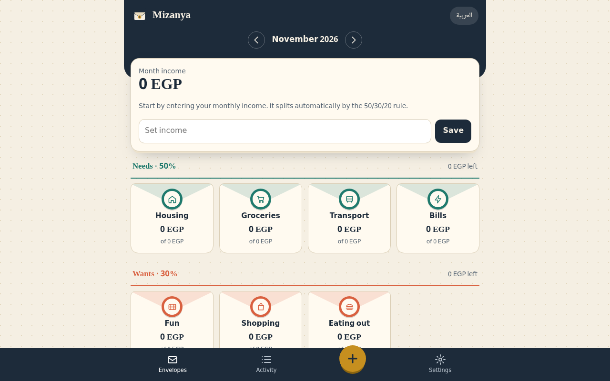
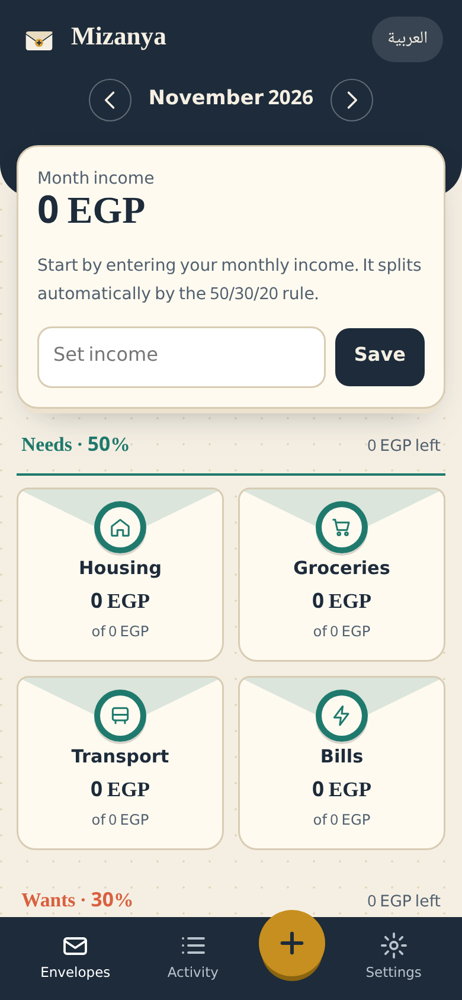
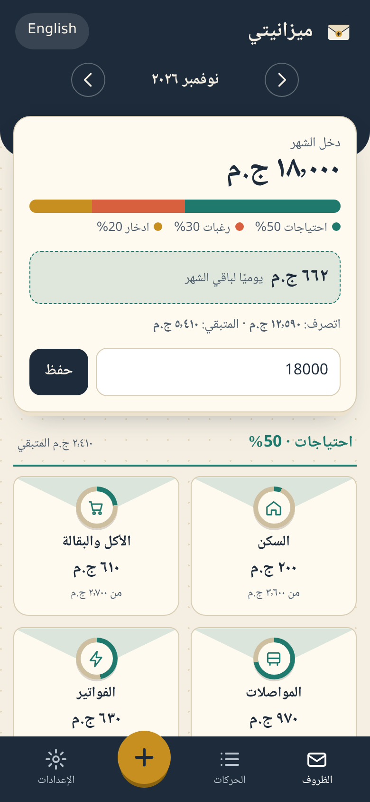
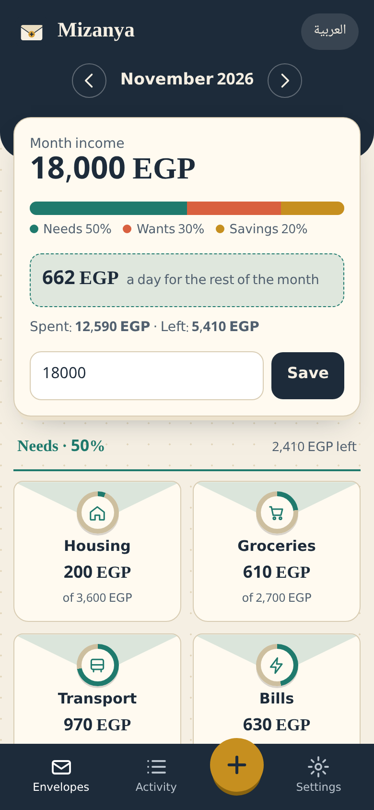
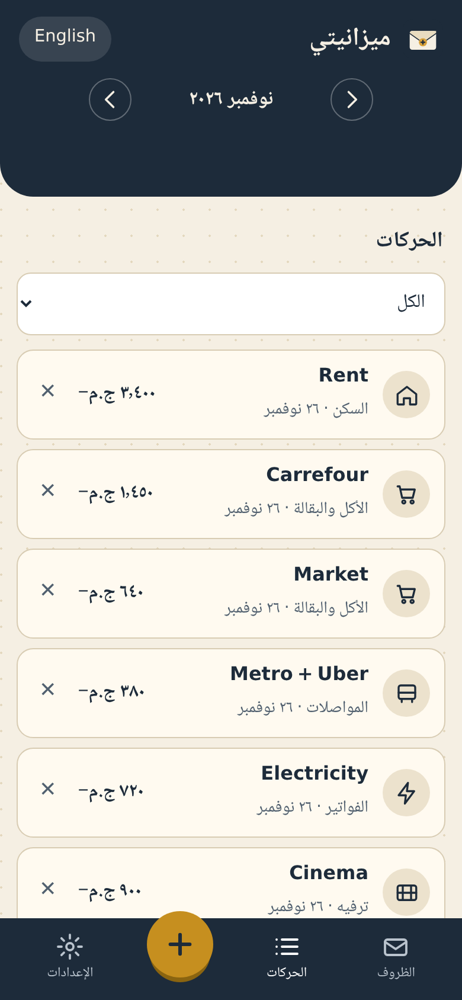
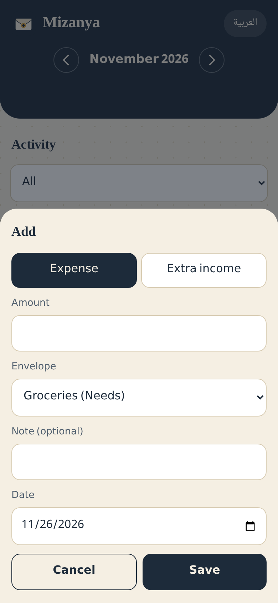
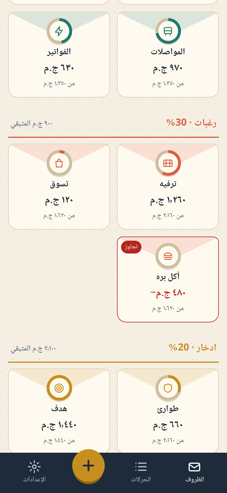
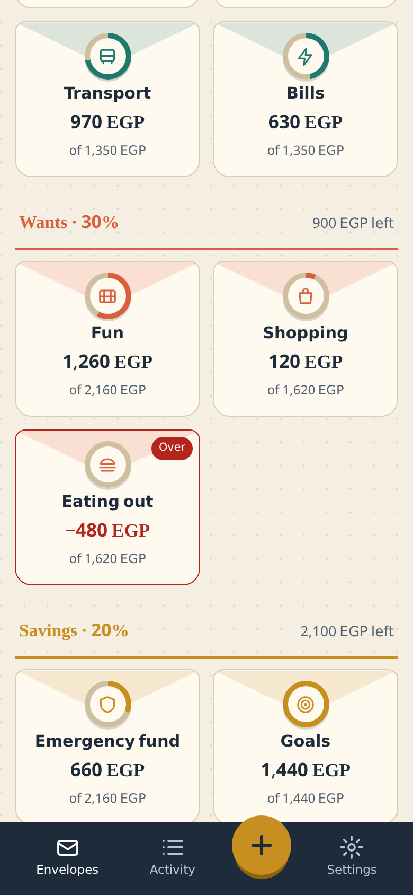

<p align="center"></p>
<h1 align="center">Mizanya | ميزانيتي</h1>
<p align="center"><b>Envelope budgeting with the 50/30/20 rule. Runs in your browser. No accounts, no server.</b><br>ميزانية بالظروف بقاعدة 50/30/20. بتشتغل في المتصفح، من غير حسابات ولا سيرفر.</p>
<p align="center"><a href="https://yousefkhames.github.io/mizanya/"><b>Open the live demo</b></a></p>

## Screenshots

Captured from the live site (https://yousefkhames.github.io/mizanya/).

<p>
  
  
</p>

## The idea

Enter your monthly income once. Mizanya splits it into **Needs 50%**, **Wants 30%** and **Savings 20%** (you can change the split), then into envelopes such as Housing, Groceries, Fun and Emergency fund. Every expense comes out of an envelope. You always see what is left, and an envelope turns red when you go over. Short on groceries but have spare in Fun? Move money between envelopes.

## Screenshots

| Arabic (RTL) | English | Activity | Add |
|---|---|---|---|
|  |  |  |  |

Envelopes view:  

## Features

- 50/30/20 split with editable percentages (must total 100)
- Envelopes with icons, custom names and relative shares inside each bucket; add or remove your own
- Expenses and extra income per envelope, with notes and dates; delete any entry
- Move money between envelopes (blocked if the source does not have enough)
- Overspend warning, per-envelope fill ring, and a "safe to spend per day" figure for the current month
- Month navigation; a new month inherits last month's income
- Arabic and English, full RTL layout, Arabic-Indic digits accepted in inputs
- Currency choice (EGP, USD, EUR, SAR, AED, GBP), light and dark themes, mobile first
- Backup and restore as JSON, month export as CSV (formula-injection safe)
- Installable and works offline (service worker, web manifest)

## Tech

Plain HTML, CSS and JavaScript. No build step, no dependencies, no network calls. State lives in `localStorage`.
`logic.js` holds all budget math as pure functions (shared by the browser and the tests). `app.js` renders the UI.

## Tests

```
npm test                                   # unit tests (node:test), 15 tests
node tests/e2e.js http://localhost:8000/   # real Chrome click-through (needs puppeteer-core)
```

The click-through drives a real browser: setting income, adding an expense with Arabic digits, overspend, transfers, deleting, language switch, month navigation, split validation, custom envelopes, reload persistence, XSS escaping, reset, offline cache, and layout overflow at 360px.

## Honest limits

- Data is stored per browser and per device. Clearing site data erases it. Use the JSON backup to move it.
- GitHub Pages is a demo host. For real use, host the files yourself or open them locally.
- No bank sync, no multi-device sync, no sharing between people.
- Envelopes reset every month; unspent money does not roll over automatically.
- Daily safe-to-spend is a simple division, not a forecast.
- Not financial advice.

## License

MIT


## Demo / portfolio project

Static GitHub Pages site. Data stays in your browser. Sample data is fictional and results are not professional, legal, medical or financial advice.

By Yousef Khames · من تطوير يوسف خميس
